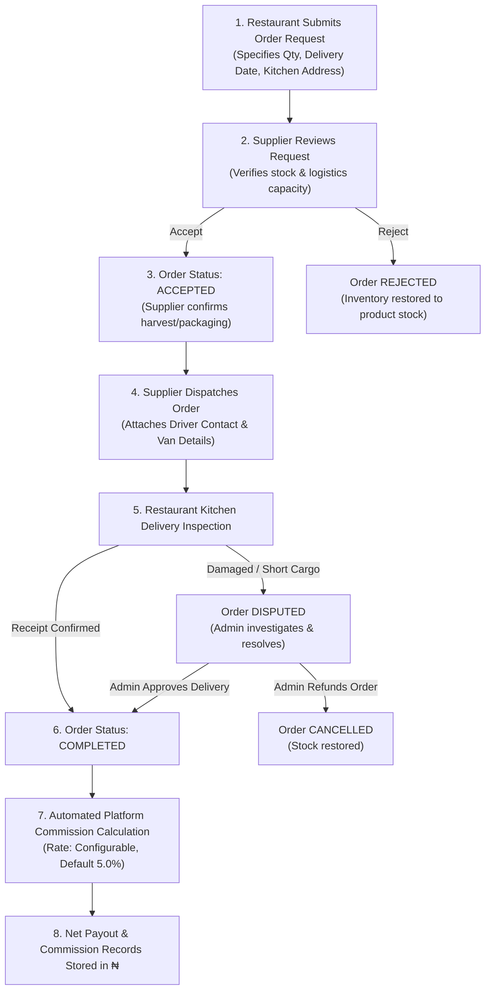

# LivestockLink Nigeria — B2B Livestock & Animal Protein Supply Brokerage

> **MVP Demonstration Platform** connecting Nigerian restaurants, hotel banquets, and caterers directly with verified poultry farmers, aquaculture operators, and meat processors.

---

## 1. Executive Summary & Business Concept

**LivestockLink Nigeria** is an asset-light B2B brokerage platform designed for the Nigerian food service economy.

### The Problem
- **Restaurants & Commercial Kitchens** suffer from unpredictable pricing, supply shortages, quality inconsistencies, and time wasted on physical market runs for meat and fish supplies.
- **Livestock Farmers & Fish Producers** face volatile farm-gate prices, middlemen extortion, and delayed payments, leaving them eager for recurring bulk commercial buyers.

### The LivestockLink Solution
- The platform functions as a **trusted digital brokerage** matching restaurant demand with farm supply.
- **Monetization**: The platform owner earns a **brokerage commission** (default 5.0%, configurable in the Admin dashboard) on completed deliveries.
- **Zero Inventory Risk**: The platform does **not** purchase livestock, own farms, or operate cold-storage warehouses. It records verified transaction values and automates commission accounting.
- **Currency**: All monetary values are strictly represented in **Nigerian Naira (₦)** with decimal precision.

---

## 2. Technology Stack

- **Backend**: ASP.NET Core Web API with C# and **.NET 9.0**.
- **Database**: PostgreSQL with **Entity Framework Core 9.0** (`Npgsql.EntityFrameworkCore.PostgreSQL`).
- **Frontend**: Clean, modern HTML5, responsive CSS3 design system, and Vanilla JavaScript (served directly via ASP.NET Core static files with zero external npm or Node.js runtime dependencies).
- **API Documentation**: OpenAPI / Swagger UI at `/swagger`.
- **Security & Auth**: JWT (JSON Web Tokens) with role-based authorization (`Restaurant`, `Supplier`, `Admin`) and BCrypt password hashing.
- **Testing**: xUnit test suite with FluentAssertions and EF Core In-Memory provider.

---

## 3. Architecture & Project Structure

```text
LivestockLink/
├── src/
│   ├── LivestockLink.Core/                 # Domain Entities, Enums, DTOs, and Interfaces
│   │   ├── Entities/
│   │   │   ├── ApplicationUser.cs         # System user (Admin, Supplier, Restaurant)
│   │   │   ├── RestaurantProfile.cs       # Restaurant business profile & address
│   │   │   ├── SupplierProfile.cs         # Farm business profile & coverage
│   │   │   ├── Product.cs                 # Livestock listings with prices & stock
│   │   │   ├── Order.cs                   # End-to-end order with workflow status
│   │   │   ├── CommissionRecord.cs        # 1-to-1 Brokerage commission record
│   │   │   ├── Dispute.cs                 # Delivery disputes & resolution
│   │   │   ├── PlatformSetting.cs         # Dynamic commission % configuration
│   │   │   └── AuditLog.cs                # System audit trail
│   │   ├── Enums/
│   │   │   ├── UserRole.cs                # Restaurant, Supplier, Admin
│   │   │   ├── ProductCategory.cs         # Poultry, CattleBeef, GoatsSheep, CatfishFish, Other
│   │   │   ├── ProductForm.cs             # LiveAnimal, ProcessedMeat, CleanedFish, SmokedDried, PackagedCuts
│   │   │   ├── OrderStatus.cs             # Submitted, Accepted, Rejected, Dispatched, Completed, Cancelled, Disputed
│   │   │   └── DisputeStatus.cs           # Pending, ResolvedRefunded, ResolvedCompleted, Rejected
│   │   ├── DTOs/                          # Strongly typed request/response transfer objects
│   │   └── Interfaces/                    # Service contracts
│   │
│   ├── LivestockLink.Infrastructure/       # EF Core, PostgreSQL DbContext, Migrations & Services
│   │   ├── Data/
│   │   │   ├── ApplicationDbContext.cs    # EF Core DbContext with precision & index configurations
│   │   │   └── DbInitializer.cs           # Automatic database creation and realistic Nigerian seed data
│   │   └── Services/
│   │       ├── AuthService.cs             # BCrypt hashing & JWT token issuance
│   │       ├── ProductService.cs          # Catalogue query, search, filtering & inventory CRUD
│   │       ├── OrderService.cs            # State machine workflow, stock reservation & delivery confirmation
│   │       ├── CommissionService.cs       # Brokerage commission math & duplicate prevention
│   │       ├── DisputeService.cs          # Dispute filing and administrator resolution
│   │       └── AdminService.cs            # Metrics aggregation & supplier approval controls
│   │
│   └── LivestockLink.Web/                  # ASP.NET Core Web API + Frontend SPA
│       ├── Controllers/                   # RESTful API Controllers
│       │   ├── AuthController.cs          # Register, Login, Me
│       │   ├── ProductsController.cs      # Catalogue, Filters, Supplier Listing Management
│       │   ├── OrdersController.cs        # Order creation, review, dispatch, confirm delivery
│       │   ├── DisputesController.cs      # Dispute filing and resolution
│       │   ├── AdminController.cs         # GMV metrics, commission rate updater, directories
│       │   └── SuppliersController.cs     # Public supplier directories
│       ├── Middleware/
│       │   └── ExceptionHandlingMiddleware.cs # Centralized error handling
│       ├── wwwroot/                       # Modern Nigerian B2B Marketplace UI
│       │   ├── index.html                 # Public landing page with 1-click demo login buttons
│       │   ├── app.html                   # Unified B2B reactive portal (all 3 roles)
│       │   ├── css/styles.css             # Agricultural-inspired palette (emerald/forest greens & warm slate)
│       │   └── js/
│       │       ├── api.js                 # API client with token management & Naira (₦) formatting
│       │       └── app.js                 # Dynamic role-based UI controller & modals
│       ├── Program.cs                     # Web host pipeline, JWT auth, Swagger, and auto-seeder
│       ├── appsettings.json
│       └── appsettings.Development.json
│
├── tests/
│   └── LivestockLink.Tests/               # Automated Unit & Integration Tests (14 passing tests)
│       ├── OrderWorkflowTests.cs          # Full lifecycle: submit -> accept -> dispatch -> complete -> commission
│       ├── CommissionCalculationTests.cs  # Accurate 5% math & duplicate prevention
│       ├── ProductValidationTests.cs      # Minimum order, stock availability & pricing rules
│       └── AuthorizationAndSecurityTests.cs# Role checks & data isolation between users
│
├── LivestockLink.sln
├── run.ps1                                # 1-click startup script for Windows
└── README.md
```

---

## 4. Pre-Seeded Demonstration Accounts

All demonstration accounts are pre-seeded automatically upon first launch.

| Role | Account Name | Email | Password | Details |
| :--- | :--- | :--- | :--- | :--- |
| **Platform Owner** | Platform Administrator | `admin@livestocklink.ng` | `Password123!` | Manages commission rate (5%), inspects GMV, reviews disputes |
| **Restaurant Buyer** | Mama Cass Eateries (Lagos) | `mamacass@livestocklink.ng` | `Password123!` | Bulk buyer of broilers and boneless beef cuts |
| **Restaurant Buyer** | Calabar Kitchen & Grills (Abuja) | `calabarkitchen@livestocklink.ng` | `Password123!` | Buyer of live table-size catfish and goat meat |
| **Supplier** | Al-Barakah Poultry Farms | `albarakah@livestocklink.ng` | `Password123!` | Moniya, Ibadan, Oyo State (Broilers, Blast-frozen cuts) |
| **Supplier** | Niger Valley Aquaculture | `nigervalley@livestocklink.ng` | `Password123!` | Asaba, Delta State (Live table catfish & smoked fish) |
| **Supplier** | Plateau Prime Beef & Processors | `plateauprime@livestocklink.ng` | `Password123!` | Bukuru, Jos, Plateau State (Fulani beef & Red Sokoto goats) |

> **Note**: The public landing page (`/index.html`) and the application portal (`/app.html`) include an **Instant 1-Click Role Switcher** dropdown in the top navigation bar, allowing immediate switching between accounts during presentations without retyping passwords.

---

## 5. Order and Brokerage Workflow

The platform implements an atomic 8-step brokerage workflow:



### Commission Calculation Example
- **Product**: Farm-Fresh Broiler Chicken (Live Birds)
- **Quantity**: 50 birds
- **Unit Price**: ₦8,000 / bird
- **Total Order Value**: **₦400,000.00**
- **Platform Commission (5.0%)**: **₦20,000.00**
- **Supplier Net Payout**: **₦380,000.00**

*Duplicate Prevention*: The database enforces a unique index on `CommissionRecord.OrderId` and the service layer checks existence before executing calculation.

---

## 6. How to Run Locally (Windows)

### Prerequisites
1. **.NET 9.0 SDK**: [Download .NET 9](https://dotnet.microsoft.com/download/dotnet/9.0) (verify with `dotnet --version`).
2. **PostgreSQL Server**: Running locally on port `5432`.
   - Default configured database: `livestocklink_db`
   - Default user: `postgres`
   - Default password in `appsettings.json`: `Dayyan1907` (can also be configured via environment variable `ConnectionStrings__DefaultConnection`).

### Method 1: Using the PowerShell Run Script
Open PowerShell in the project root directory:
```powershell
.\run.ps1
```

### Method 2: Manual Terminal Commands

1. **Restore dependencies**:
   ```powershell
   dotnet restore
   ```

2. **Run automated test suite**:
   ```powershell
   dotnet test
   ```
   *(All 14 tests will pass)*

3. **Start the Web API & Portal**:
   ```powershell
   dotnet run --project src/LivestockLink.Web --urls "http://localhost:5000"
   ```

4. **Access the Application**:
   - **Marketplace Web Portal**: Open [http://localhost:5000](http://localhost:5000)
   - **Interactive OpenAPI / Swagger Documentation**: Open [http://localhost:5000/swagger](http://localhost:5000/swagger)

---

## 7. Interactive Live Demonstration Script

To present this MVP to partners, mentors, and investors:

1. **Visit the Landing Page** ([http://localhost:5000](http://localhost:5000)):
   - Highlight the value proposition: Direct farm-gate sourcing for restaurants with zero inventory risk for the platform.
2. **Click "Restaurant: Mama Cass (Lagos)"**:
   - Navigate to the **Product Catalogue**.
   - Filter by category ("Catfish & Aquaculture") or search "Catfish".
   - Click **"Request Order"** on *Live Table-Size African Catfish*.
   - Adjust quantity (e.g., 25 kg @ ₦3,500 = ₦87,500). Notice the **live price calculation** updating in Nigerian Naira.
   - Click **"Submit Order Request"**.
3. **Switch to "Supplier: Niger Valley Catfish"** (using the top navigation dropdown):
   - Notice the incoming order in the queue with status **Submitted**.
   - Click **"Accept"** to confirm availability.
   - Click **"Dispatch"**, enter refrigerated vehicle plate (`LAG-442-XY`) and driver contact (`Kenneth +2348039988112`).
   - Order moves to **Dispatched** (en route).
4. **Switch back to "Restaurant: Mama Cass"**:
   - Go to **My Orders & Deliveries**.
   - Notice the order is marked **Dispatched** with driver contact info visible.
   - Click **"Confirm Delivery"**.
5. **Switch to "Platform Owner / Admin"**:
   - Open the **Platform Overview**.
   - Notice the Gross Merchandise Value (GMV) and Commission Revenue automatically incremented!
   - Demonstrate updating the **Platform Commission Rate** (e.g. from 5.0% to 6.5%).
   - Open **Disputes Center** to review and resolve any delivery discrepancy.

---

## 8. Implemented Features & Known Limitations

### Implemented Features
- [x] Full role-based authentication (JWT + BCrypt) with 3 roles: Restaurant Buyer, Supplier, Admin.
- [x] Complete database entities with PostgreSQL decimal precision for Nigerian Naira (`₦`).
- [x] Dynamic catalogue filtering by category, product form, supplier, price range, and search keyword.
- [x] Strict server-side price snapshots (buyers cannot alter unit prices or total amounts).
- [x] End-to-end atomic order state machine (Submitted -> Accepted/Rejected -> Dispatched -> Completed/Cancelled/Disputed).
- [x] Automated platform commission calculation upon delivery confirmation.
- [x] Unique constraint duplicate commission prevention.
- [x] Minimum order quantity and available stock validation.
- [x] Inventory reservation on order submission and automatic inventory restoration on cancellation or rejection.
- [x] Real-time delivery dispute filing and administrator resolution workflows.
- [x] Admin dashboard with GMV aggregation, commission stats, supplier approval/suspension, and commission rate adjustment.
- [x] Automatic database schema migration and realistic Nigerian seed data.
- [x] 14 passing automated unit and integration tests.

### Known Limitations (MVP Scope)
- **Direct Financial Payments**: In line with MVP specifications, payments are settled directly between restaurant and supplier. No third-party fintech or escrow gateway (Paystack/Flutterwave) is integrated to keep the local demonstration free of paid API keys.
- **Push Notifications / SMS**: Order state changes update in real time in the web application; SMS gateway integration (e.g. Termii) is omitted for this offline-friendly demonstration.
